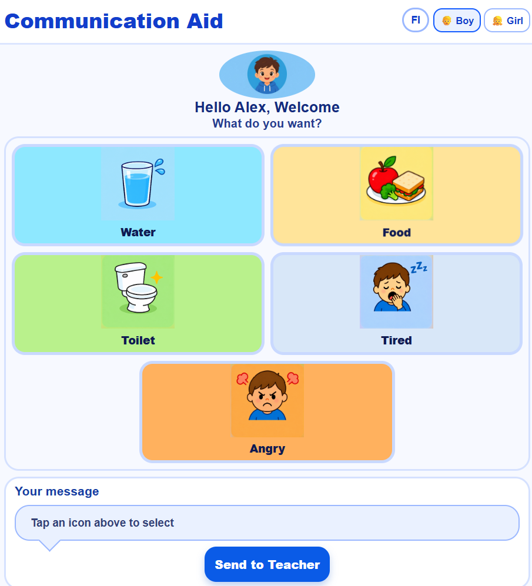
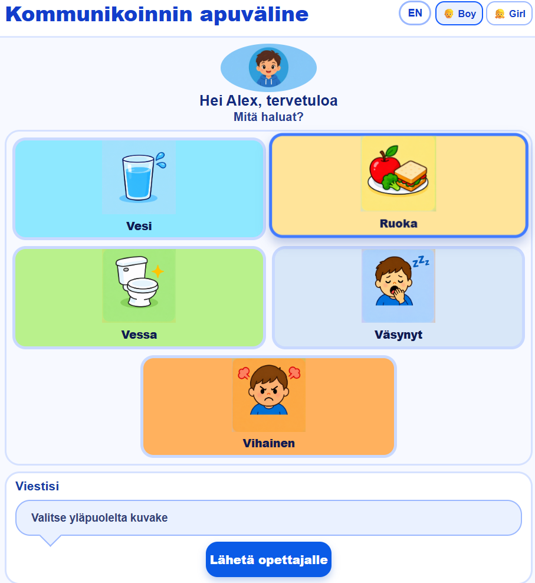

# Communication Aid App

An Electron desktop communication aid for students who benefit from selecting clear visual needs. The student can choose an icon, see the related sentence, and hear it spoken aloud.

## Version

The current release is **1.2.0**. It builds on the original 1.0.0 interface with profile setup, local recorded audio, and transparent tile artwork.

## Features in version 1.0.0

- Five visual communication tiles: Water, Food, Toilet, Tired, and Angry.
- A teacher profile-setup dialog for student name, age, date of birth, gender, and language.
- English and Finnish interface translations selected from the saved profile.
- Local boy/girl voice recordings for each active tile in both languages.
- A first-time setup prompt using `kids_voices/user_profile_setup.mp3`.
- A settings button that reopens the saved student profile.
- A visible selected-message area.
- A "Send to Teacher" button that currently shows an availability message; it does not yet send a message.
- Electron desktop application window.

## Screenshots

| English                                              | Finnish                                              |
| ---------------------------------------------------- | ---------------------------------------------------- |
|  |  |

## Run the app

### Prerequisites

- [Node.js](https://nodejs.org/)
- npm

### Installation and start

From the `comm_app` folder, install the dependencies and start Electron:

```bash
npm install
npm start
```

## How to use

1. Select **Settings** and enter the student profile details.
2. Select **OK** to load the matching profile image, language, and local voice recordings.
3. Select a need tile to display and play the selected message.
4. Select **Settings** again whenever the profile needs to be changed.
5. Select **Send to Teacher** to see the current placeholder notification.

## Project structure

```text
comm_app/
├── index.html        # Application structure and communication tiles
├── style.css         # Layout, colours, tile styling, and responsive rules
├── script.js         # Translations, tile interaction, and speech synthesis
├── index.js          # Electron main process and window configuration
├── images/           # Student, original, and transparent communication-tile images
├── kids_voices/      # Local English and Finnish recordings for boy and girl profiles
├── App_demo_en.png   # English screen example
├── App_demo_fi.png   # Finnish screen example
└── package.json      # Electron dependency and npm start command
```

## Version 1.1.0 changes

Version 1.1.0 introduced personalisation and layout improvements:

- Remove the app title from the header to create more space for the communication screen.
- Enable a Boy/Girl toggle button so the student version can be selected.
- Remove the face from the Water tile image.
- Improve responsive layouts, including a mobile breakpoint so the tiles and controls fit smaller screens.
- Default Electro title/taskbar logo replaced with custom windows icon.

## Authors

Roshan, Darshika, and Nimesha.

## Links

- [GitHub repository](https://github.com/Karelia-Software-Projetcs/communication_app)
- [Online demo](https://karelia-software-projetcs.github.io/communication_app/)

## Version 1.2.0 changes

- Replaced the header language and gender controls with one **Settings** button.
- Added a student profile setup form for name, age, date of birth, gender, and language.
- Saved the student profile locally so the selected profile loads when the app opens again.
- Added a clickable student profile image and welcome message that display a summary of the saved student details.
- Added local boy and girl voice recordings for every need tile in English and Finnish.
- Added `user_profile_setup.mp3`, which plays when the teacher opens the Settings form.
- Added transparent tile-image versions so the Water, Food, Toilet, Tired, and Angry tile colours are clearly visible.
- Simplified the Electron menu bar by removing the **Edit** and **Window** menus while keeping **File** and **View**.
